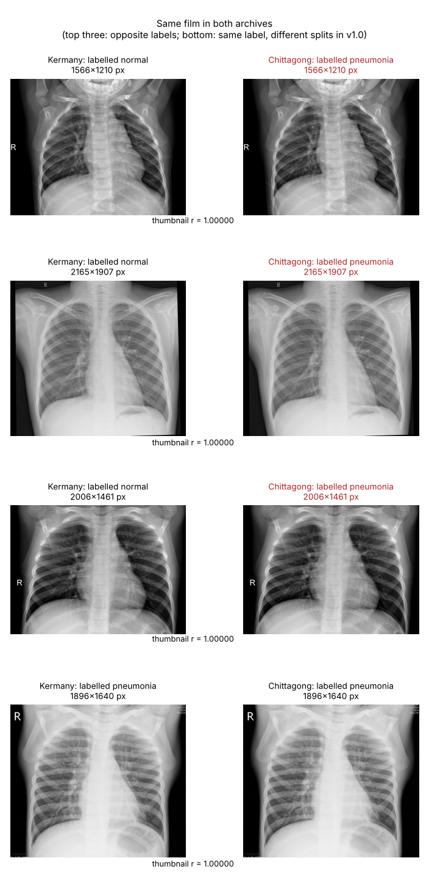

# Duplicate audit of the two source archives

This note explains why version 1.0 of this project was withdrawn, what the audit found, and why the data were rebuilt the way they were. The numbers below come from `reports/prepare_summary.json` and `reports/duplicate_clusters.csv`.

## Why the audit was done

Version 1.0 removed duplicates only when two files had the same SHA-256 or exactly the same 16×16 grayscale thumbnail. Its own limitations section noted that near-copies could survive that check. A review of the published results also showed something odd: each source scored a higher test AUC on its own than the two sources did together. That pattern suggests a problem between the archives rather than within one of them.

## Method

All images in the v1.0 working set were downsampled to 32×32 and compared pairwise by Pearson correlation. Correlation ignores the brightness and contrast shifts that re-saving an image introduces. Suspected pairs were then viewed side by side.

The pairs were not borderline. Every copy correlated at 0.9999 or above, and the next most similar pair of different films was below 0.98. The exact 16×16 check had missed them because the copies' thumbnails differed by one grey level in a few pixels, from JPEG re-encoding. Some copies had also been resized (512 vs. 1024 pixels).

## What it found

In the v1.0 working set of 3,000 images:

- 292 pairs of the same film had survived de-duplication;
- 117 of those pairs carried **opposite labels**: a Kermany normal film saved again as a Chittagong pneumonia film;
- 85 test images had a copy in the training or validation split.

Running the improved check on the full download (8,482 images) showed the scale:

- 1,576 clusters of copies, 337 of them with conflicting labels;
- **all 1,306 Chittagong pneumonia images** are copies of Kermany films, and 337 of them copy Kermany *normal* films;
- of 1,320 Chittagong normal images, 211 copy Kermany normals and 1,109 have no match in Kermany.

So the Chittagong archive (version 4) contributes no pneumonia images of its own, and part of its pneumonia class consists of relabelled normal films.

## Decisions

**Conflicting labels.** For the 337 conflicting clusters there were three options:

| Option | Problem |
| --- | --- |
| Keep both copies | The model trains on the same image with both labels, and the test set can contain copies of training images. |
| Relabel to one archive's label | This assumes that archive is right. Neither archive's labels were re-read by a radiologist for this project, so there is no basis for choosing. |
| **Drop every copy** (chosen) | Loses 338 Kermany normal films, but keeps no label that might be wrong. |

**Which data to train on.** With every Chittagong pneumonia image removed, Chittagong could only contribute normal films. Mixing them into training would make "looks like a Chittagong film" a shortcut for "normal". Train, validation, and test therefore use Kermany only. The 1,006 unique Chittagong normal films became an **external check**: they cannot measure sensitivity, but they show how often each model calls another archive's normal films pneumonia.

## Effect on the results

| | v1.0 | v2.0 |
| --- | ---: | ---: |
| Logistic regression, test AUC | 0.908 | 0.986 |
| ResNet-18, test AUC | 0.924 | 0.989 |
| ResNet-18 specificity on 1,006 external normals | – | 0.261 |

The duplicates made v1.0 look *worse*, not better: on the 117 contradictory pairs no model can be right on both copies. (Re-scoring the v1.0 models with the 85 contaminated test images removed already raised their AUCs to 0.939 and 0.945; the rest of the jump comes from training and testing on one archive.) Once the duplicates are gone, both models score about 0.99 on Kermany, but they call 33% (logistic regression) and 74% (ResNet-18) of the external normal films pneumonia. The cleaned data show a generalisation problem that the contaminated data had hidden.

## Reproducing the audit

`python -m src.data.prepare` performs the de-duplication and writes `reports/duplicate_clusters.csv`, one row per image in a cluster, with its source, label, hash, archive path, and the decision taken (`kept`, `dropped_duplicate`, or `dropped_label_conflict`). The threshold is `dedup_correlation` in `configs/default.yaml`.
